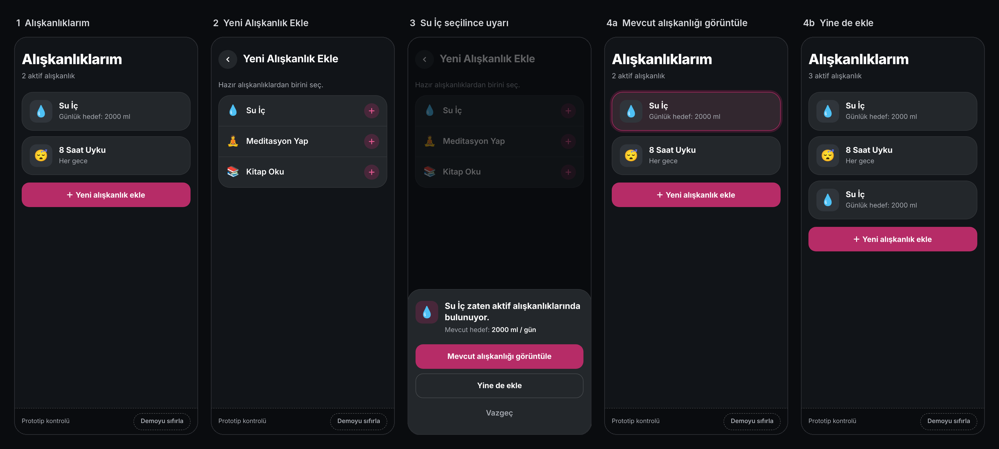

# D-Plan — Tekrarlanan Hazır Alışkanlık Uyarısı (Prototip)



## 1. Prototipin amacı

Bu prototip, D-Plan için önerdiğim tek bir küçük ürün iyileştirmesini çalışır halde göstermek için hazırlandı: kullanıcı, aktif alışkanlıklarında zaten bulunan bir hazır alışkanlığı tekrar eklemek istediğinde onu engellemeden bilgilendirmek.

Prototip yalnızca bu duplicate hazır alışkanlık akışını gösterir.

## 2. Gösterilen problem

D-Plan'da "Su İç" gibi uygulamanın sunduğu hazır alışkanlıklar var. Kullanıcı, aynı hazır alışkanlık aktif listesinde zaten bulunsa bile onu tekrar ekleyebiliyor.

"Su İç" yalnızca "yaptım" diye işaretlenen bir alışkanlık değil; kullanıcı gün içindeki su tüketimini bu alışkanlık üzerinden miktar olarak takip ediyor. Aynı alışkanlık yanlışlıkla ikinci kez eklendiğinde aynı hedef iki ayrı kayıtta takip edilmeye başlıyor ve bu kafa karışıklığına yol açabiliyor.

## 3. Önerilen çözüm

Kullanıcı "Yeni Alışkanlık Ekle" ekranında hazır bir alışkanlık seçtiğinde, aynı hazır alışkanlığın aktif listede bulunup bulunmadığı kontrol edilir.

- Listede yoksa alışkanlık doğrudan eklenir ve "Alışkanlıklarım" ekranına dönülür.
- Listede varsa kullanıcı engellenmez; alttan açılan küçük bir uyarı gösterilir: "Su İç zaten aktif alışkanlıklarında bulunuyor." Uyarıda mevcut kayda ait kısa bir bilgi de yer alır: "Mevcut hedef: 2000 ml / gün".

Uyarıdaki seçenekler:

| Seçenek | Sonuç |
| --- | --- |
| Mevcut alışkanlığı görüntüle | Uyarı kapanır, "Alışkanlıklarım" ekranına dönülür, mevcut alışkanlık kartı ekrana getirilir ve yaklaşık 2 saniye vurgulanır. |
| Yine de ekle | Kullanıcı engellenmez. İkinci kayıt oluşturulur ve "Alışkanlıklarım" ekranına dönülür. |
| Vazgeç | Uyarı kapanır, kullanıcı "Yeni Alışkanlık Ekle" ekranında kalır. Uyarının dışındaki karartılmış alana dokunmak da aynı sonucu verir. |

Kullanıcının ikinci alışkanlığı oluşturması engellenmez; yalnızca olası duplicate konusunda bilgilendirilir. Bilinçli olarak tekrar eklemek isteyen kullanıcı tek dokunuşla devam edebilir.

Kontrol, prototipteki hazır alışkanlık kimliği (`presetId`) üzerinden yapılır. İsim karşılaştırması, NLP, fuzzy matching veya yapay zekâ kullanılmaz.

## 4. Nasıl çalıştırılır

Gereksinim: Node.js 20.19+ veya 22.12+

```bash
npm install
npm run dev
```

Terminalde görünen adresi (varsayılan: http://localhost:5173) tarayıcıda açın.

Prototip mobil görünüm öncelikli tasarlandı. Masaüstünde tarayıcının geliştirici araçlarındaki cihaz modunu kullanabilir veya pencereyi yaklaşık 390–430 px genişliğe daraltabilirsiniz. Aynı ağdaki bir telefondan açmak için `npm run dev -- --host` komutunu çalıştırıp terminalde görünen "Network" adresini kullanın.

## 5. Demo akışı

Prototip iki ekrandan oluşur:

- **Alışkanlıklarım:** yalnızca aktif alışkanlıkları gösterir.
- **Yeni Alışkanlık Ekle:** yalnızca hazır alışkanlıkları gösterir.

Uygulama "Alışkanlıklarım" ekranında açılır. Listede "Su İç" (Günlük hedef: 2000 ml) ve "8 Saat Uyku" (Her gece) bulunur.

1. **Yeni alışkanlık ekle**'ye basın. "Yeni Alışkanlık Ekle" ekranı açılır.
2. **Meditasyon Yap**'ı seçin. Aktif listede olmadığı için doğrudan eklenir ve "Alışkanlıklarım" ekranına dönülür.
3. Tekrar **Yeni alışkanlık ekle**'ye basıp **Su İç**'i seçin. Zaten aktif olduğu için uyarı açılır ve mevcut hedef gösterilir.
4. **Vazgeç**'e basın. Uyarı kapanır, "Yeni Alışkanlık Ekle" ekranında kalırsınız.
5. Tekrar **Su İç**'i seçip **Mevcut alışkanlığı görüntüle**'ye basın. "Alışkanlıklarım" ekranına dönülür ve mevcut Su İç kartı yaklaşık 2 saniye vurgulanır.
6. **Yeni alışkanlık ekle** → **Su İç** → **Yine de ekle** adımlarını izleyin. Listeye ikinci bir Su İç kaydı eklenir.

Ekranın altındaki "Prototip kontrolü" şeridinde bulunan **Demoyu sıfırla**, başlangıç durumuna döndürür. Bu şerit ürünün bir parçası değildir; yalnızca prototipi tekrar tekrar denemeyi kolaylaştırır.

## 6. Kapsam notu

Bu çalışma D-Plan’ın gerçek veri modeli veya backend mimarisini temsil etmez. Yalnızca önerilen kullanıcı deneyimi akışını göstermek amacıyla hazırlanmış bir prototiptir.

- Prototip yalnızca duplicate hazır alışkanlık akışını gösterir.
- D-Plan'ın gerçek veri modelini temsil etmez. `presetId` alanı yalnızca prototipteki kontrolü gösterebilmek için tanımlanmıştır.
- Miktar/süre yapılandırma adımı bilinçli olarak kapsam dışındadır.
- Kullanıcının ikinci alışkanlığı oluşturması engellenmez; kullanıcı yalnızca olası duplicate konusunda bilgilendirilir.
- Ekranın altındaki "Prototip kontrolü" şeridi ve "Demoyu sıfırla" gerçek ürün arayüzünün parçası değildir; prototipi deneyen kişinin akışı baştan başlatabilmesi için vardır.

D-Plan'ın gerçek akışında hazır alışkanlık seçildikten sonra miktar, süre veya benzeri alışkanlık ayarları yapılabilir. Bu yapılandırma adımı, prototipin ele aldığı duplicate-awareness problemiyle ilgili olmadığı için bilinçli olarak kapsam dışında bırakılmıştır.

Gerçek üründe "Yine de ekle" aksiyonundan sonra normal alışkanlık yapılandırma akışı devam edebilir. Bu prototipte miktar/süre yapılandırması kapsam dışında bırakıldığı için örnek kayıt doğrudan oluşturulur.

Prototipte backend, veritabanı, kimlik doğrulama, API, yönlendirme (routing) kütüphanesi veya yapay zekâ entegrasyonu yoktur. Ekran geçişleri ve tüm veri React state içinde tutulur; sayfa yenilendiğinde başlangıç durumuna döner.
